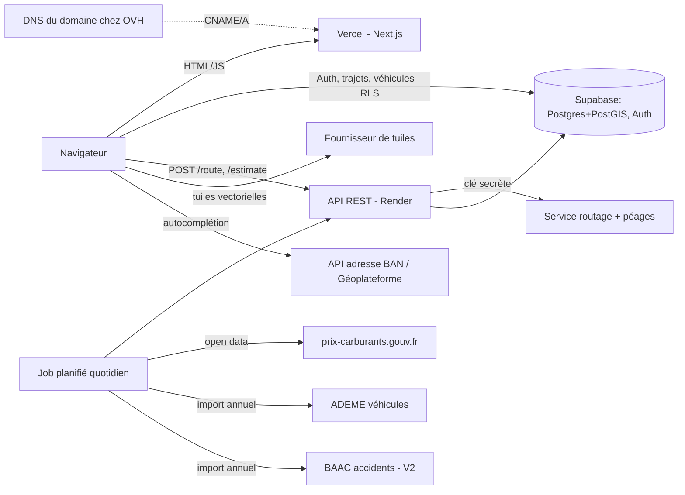

# 03 — Architecture et stack

## Vue d'ensemble

**Principe clé** : l'API renvoie un itinéraire *décomposé en segments* (distance, vitesse limite, classe de route, péage). Le **moteur de coût** (package TypeScript pur) transforme ces segments en euros. Il est exécuté **dans le navigateur** → les curseurs (vitesse, véhicule, carburant) recalculent instantanément sans rappeler l'API ni payer de routage. Le même code tourne côté API pour les jobs et les tests.

## Stack recommandée

| Couche | Choix | Raison | Réversibilité |
|---|---|---|---|
| Front | **Next.js (App Router) + TypeScript**, Tailwind, TanStack Query | Natif Vercel ; pages d'itinéraires pré-générées pour le SEO ; la carte reste un composant client | Moyenne |
| Carte | **MapLibre GL JS** (open source) | Pas de vendor lock-in, calques custom (sinueux/danger) faciles | Moyenne |
| Tuiles | Fournisseur à tarif gratuit généreux (ex. MapTiler/Stadia ⚠️ à vérifier) ou Protomaps auto-hébergé | La politique d'usage des tuiles OSM officielles interdit la prod à fort trafic | Facile |
| Auth + BDD | **Supabase** (Postgres, PostGIS, Auth email + Google, RLS) | Imposé, couvre auth + données géo | Difficile (mais standard Postgres) |
| API | **Node + Fastify + Zod** (TypeScript) sur Render | Même langage que le front, types partagés, schémas validés | Facile |
| Moteur de coût | package `cost-engine` (TS pur, sans dépendance) | Partagé front/API, très testable | — |
| Routage | À trancher par spike (voir ci-dessous) | Dépend de la solution péages | Facile si derrière un adaptateur |
| Géocodage | API Adresse (BAN / Géoplateforme IGN), gratuite, France ⚠️ vérifier l'URL actuelle | Pas de clé, adaptée à la France | Facile |
| CI/CD | GitHub → Vercel (déploiement auto + previews par branche) ; Render auto-deploy depuis GitHub ; GitHub Actions pour lint/tests | | Facile |
| Monorepo | `apps/web`, `apps/api`, `packages/cost-engine`, `packages/shared` (pnpm workspaces) | Partage des types | Facile |

### Pourquoi une API maison est nécessaire (et pas seulement Supabase)
1. **Clés secrètes** du service de routage/péage (ne jamais les mettre dans le front).
2. **Cache** des itinéraires (même origine/destination) pour limiter les appels payants.
3. **Jobs** : import prix carburants, ADEME, BAAC.
4. **Rate limiting** pour protéger le quota.
Si le routage retenu n'a pas de clé secrète (auto-hébergé), l'API pourrait se réduire à des Edge Functions Supabase. À reconsidérer après le spike.

### Hébergement Vercel + domaine OVH — points d'attention
- **Domaine** : il reste chez OVH (registrar). On ajoute le domaine dans Vercel, puis on crée chez OVH (zone DNS) l'enregistrement demandé par Vercel : CNAME pour un sous-domaine (`trajet.mondomaine.fr`) ou A pour le domaine nu. HTTPS géré automatiquement par Vercel. Aucun hébergement OVH n'est nécessaire. ⚠️ Vérifier les valeurs exactes affichées dans Vercel et le délai de propagation DNS.
- **Plan Hobby (gratuit)** : ⚠️ réservé à un usage non commercial selon les conditions de Vercel (à relire). Le projet étant 100 % gratuit et sans pub, il est compatible. **Si des pubs étaient ajoutées un jour**, le site deviendrait commercial : migrer le front vers un hébergeur gratuit qui l'autorise (ex. Cloudflare Pages ⚠️ à vérifier) plutôt que payer Vercel Pro. Next.js se déploie ailleurs, donc c'est réversible.
- **Limites du gratuit** : quotas de bande passante et d'exécution de fonctions ⚠️ à vérifier ; ne pas faire de calcul lourd dans les fonctions Vercel.
- **SEO** : Next.js permet de générer des pages `Paris → Lyon` (SSG/ISR) avec prix indicatif, ce qui était impossible avec une SPA sur mutualisé.
- **Rôle de l'API Render** : inchangé (clés routage, cache, jobs). Des routes API Next.js existent mais on garde Render pour séparer le front du back, comme prévu. À reconsidérer si on veut une seule plateforme.
- **Variables publiques** : tout ce qui est préfixé `NEXT_PUBLIC_` est visible par le navigateur ; jamais de clé secrète ici.

## Options pour les 2 décisions risquées

### D1 — Routage + péages (⚠️ le plus important)
| Option | Péages | Coût | Contrainte | Verdict provisoire |
|---|---|---|---|---|
| **A. HERE Routing** (ou TomTom) | Coût des péages renvoyé par l'API ⚠️ à vérifier pour la France | Offre gratuite limitée ⚠️ | Conditions d'usage de l'affichage | **Candidat n°1** à tester |
| **B. Google Routes API** | Péages renvoyés | Payant au-delà d'un crédit | Résultats à afficher sur carte Google (incompatible MapLibre) | Écarté sauf changement de carte |
| **C. OpenRouteService / GraphHopper / Valhalla / OSRM** (hébergé ou auto-hébergé) | **Pas de coût de péage** ; on peut éviter ou détecter les péages (tag OSM `toll=yes`) | Gratuit / quota ; auto-héberger la France demande de la RAM (>512 Mo, hors free tier Render) | Péages à estimer soi-même | Candidat n°2 : routage OSM + **barème péages maison** |
| **D. Barème maison** : table €/km par concession (classe 1) + gares | Précision moyenne ; maintenance annuelle (tarifs changent chaque 1er février environ ⚠️) | Gratuit | Beaucoup de travail de données | Solution de repli de C |

Recommandation : **spike de 2-3 jours** comparant A et C+D sur le benchmark de 10 trajets (voir 05). Mettre le routage derrière une interface `RoutingProvider` pour pouvoir changer.

### D2 — Hébergement de l'API
| Option | Avantage | Inconvénient |
|---|---|---|
| Render gratuit | 0 € | Mise en veille après inactivité → premier appel lent (dizaines de secondes ⚠️ à vérifier) |
| Render payant (petit plan, ~7 $/mois ⚠️) | Toujours actif | Coût |
| Ping de maintien en éveil | Gratuit | Bricolage fragile, ne pas en dépendre |
Reco : démarrer gratuit, afficher un état de chargement explicite, passer au plan payant dès l'ouverture publique.

## Sécurité (base)
- RLS activée sur *toutes* les tables ; clé `service_role` uniquement côté API (jamais front).
- Variables d'environnement Render, `.env` ignoré par git, secret scanning GitHub.
- CORS restreint au domaine ; limites de débit (par IP et par utilisateur) ; validation Zod ; pas de requête SQL concaténée.
- Captcha / protection anti-abus sur l'inscription si du spam apparaît.

## Qualité
Tests unitaires du moteur de coût (cas de référence chiffrés), test d'intégration API avec un `RoutingProvider` simulé, tests RLS (SQL), lint + typecheck en CI, ADR dans `docs/decisions.md`.
