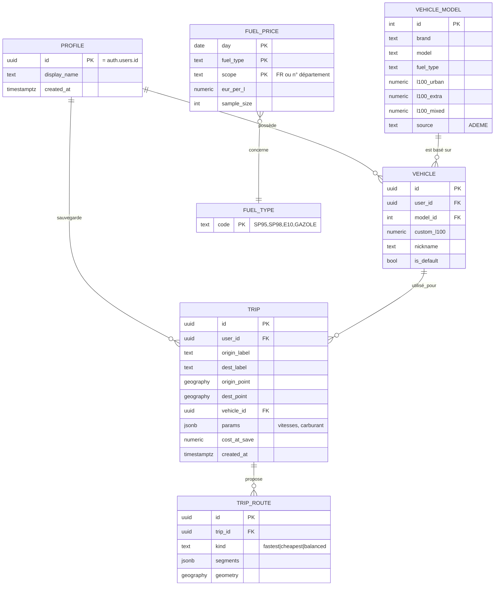

# 04 — Données et formule de calcul

## Modèle de données (Supabase / Postgres)



Tables de référence publiques en lecture seule (`vehicle_model`, `fuel_price`) ; tables utilisateur (`profile`, `vehicle`, `trip`, `trip_route`) protégées par RLS : `user_id = auth.uid()`.
Pour la V2 : `road_segment_risk` (géométrie PostGIS, nb accidents, gravité, indice de sinuosité) avec index GIST.

> On stocke l'**entrée** (origine, destination, véhicule, paramètres) plutôt que seulement le résultat : un trajet sauvegardé peut être recalculé avec le prix du jour. Le coût du jour de la sauvegarde est conservé pour comparaison.

## Formule de coût (moteur `cost-engine`)

Pour chaque segment *i* de l'itinéraire (longueur `d_i` en km, classe de route, vitesse de croisière `v_i`) :

```
litres_i  = d_i × conso_ref(classe_i) / 100 × facteur_vitesse(v_i)
coût_carburant = Σ litres_i × prix_litre
coût_péages    = Σ péage_i                      (fourni par le routage OU barème maison)
durée          = Σ d_i / v_i  (+ temps d'arrêt éventuels)
coût_total     = coût_carburant + coût_péages [+ coûts annexes V2 : usure…]
```

- `conso_ref(classe)` : issue de l'ADEME — urbain pour traversées de villes, extra-urbain pour routes, mixte (ou extra-urbain corrigé) pour autoroute. Si l'utilisateur ne donne qu'une conso mixte manuelle, on dérive les autres par ratios moyens ⚠️ à calibrer.
- `facteur_vitesse(v)` : courbe en U (minimum autour de 70-90 km/h, hausse nette au-delà de ~110 km/h à cause de la traînée aérodynamique ~ v²). Valeurs initiales **à calibrer** sur le benchmark et sur des données publiées ⚠️ ; paramétrables dans un fichier de configuration versionné.
- `vitesse v_i` = min(vitesse limite du segment, vitesse choisie par l'utilisateur) × coefficient de fluidité (< 1 en agglomération). La vitesse choisie pour l'autoroute (110/130) est le curseur principal.
- Prix : moyenne nationale du jour pour le carburant choisi (MVP) ; moyenne des départements traversés pondérée par la distance (V1).
- **Précision visée** ±10 % ; on affiche une fourchette (« 62–70 € ») plutôt qu'un chiffre faussement précis.

Exemple de cas de test à écrire avant de coder : trajet fictif de 100 km tout autoroute, véhicule 5,0 L/100, prix 1,80 €/L, péage 10 € → carburant ≈ 9 € × facteur(vitesse), total ≈ 19 €+. Les cas de référence réels viendront du benchmark.

## Sources de données (⚠️ vérifier licences et formats avant d'intégrer)

| Donnée | Source pressentie | Fréquence | Usage |
|---|---|---|---|
| Prix carburants | Open data « Prix des carburants en France » (data.gouv.fr / prix-carburants.gouv.fr) | Quasi temps réel ; on snapshote 1×/jour | MVP |
| Consommation véhicules | ADEME « Car Labelling » (data.gouv.fr / data.ademe.fr) | Annuelle | MVP |
| Adresses | API Adresse (BAN / Géoplateforme) | Continu | MVP |
| Réseau routier / vitesses limites / `toll=yes` | OpenStreetMap (via routage) | Continu | MVP |
| Péages | HERE/TomTom **ou** barème concessionnaires | Annuelle (tarifs) | MVP — **spike** |
| Accidents | BAAC (Base de données accidents corporels, ONISR, data.gouv.fr) | Annuelle | V2 |
| Altitude (routes de montagne) | Modèle numérique de terrain (IGN/SRTM) | Statique | V2 |

Rappel : aucun téléchargement n'a été fait ; chaque import sera décidé avec toi.

## Sinuosité et dangerosité (V2)

- **Sinuosité** : par fenêtre glissante de ~1 km sur la géométrie, indice = longueur réelle / distance à vol d'oiseau, ou somme des changements de cap par km. Classe : droite / vallonnée / sinueuse / très sinueuse. Calculable à la volée sur l'itinéraire (aucune donnée externe).
- **Dangerosité** : rattacher les accidents BAAC (points GPS) aux tronçons (snap PostGIS), normaliser par longueur (et par trafic si disponible, sinon indicatif seulement), classer en quantiles. Affichage en calque coloré + disclaimer : *indicateur statistique historique, pas une prévision*. Attention aux biais (routes très fréquentées = plus d'accidents bruts).
- Les deux alimentent un **score de « confort/risque »** affiché à côté du coût, et optionnellement un filtre d'alternatives.
